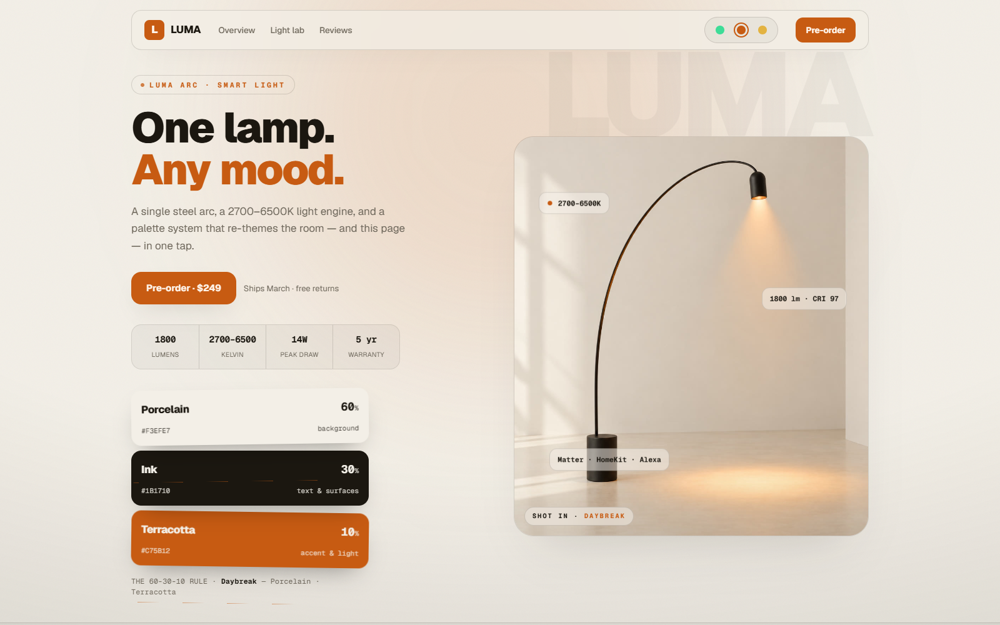

# LUMA Arc · a landing page run by one palette

A product landing page **and its auth-gated checkout**, where **one 60-30-10 palette drives everything**: the base, the surfaces, the accent — the glass, the product shots, even the light of the lamp. Switch the palette and the whole flow re-themes in one tap.
Built with **Next.js 16 · TypeScript · Tailwind CSS v4 · Motion**.

**Live demo → [codewithdolly.vercel.app/luma](https://codewithdolly.vercel.app/luma/)** · **[the checkout](https://codewithdolly.vercel.app/luma/checkout/)**



## Why this repo is useful (beyond the demo)

The palette switcher looks like a gimmick. The architecture behind it is not — it's the exact setup you need for:

- **Dark mode** that isn't 400 `dark:` classes: one palette object per mode, components never change.
- **White-label / multi-brand products:** ship the same tree, swap the token file per client.
- **Product configurators:** the FlexLamp (pointer-drag SVG with derived geometry) and the Kelvin slider are the same patterns behind "pick your fabric / stone / trim" e-commerce UIs.

## Features

- **60-30-10 tokens:** each palette is a typed object (`c60/c30/c10` + CSS vars). `paletteStyle()` turns it into custom properties on one wrapper div.
- **Zero hard-coded colors in components:** everything reads `var(--bg/--fg/--accent/--border/--glass)`. Glass and tints are built with `color-mix`, so they survive light *and* dark bases.
- **Product shots per palette:** the hero and variant cards crossfade between renders that match each palette (images generated for this demo — swap in your product photography).
- **The flexible arc:** grab the lamp head and drag it on both axes. The sprung-steel arc is a cubic bézier recomputed from the head position; the light cone and floor pool follow, with reach/height/pool readouts.
- **Light lab:** a 2700–6500K range slider with a live bulb preview.
- **An auth-gated checkout** (`/checkout`): register with a live password-strength meter, step-by-step unlock (account → shipping → payment), a card preview that types itself with Luhn validation and brand detection (test with `4242 4242 4242 4242`), a promo engine (`LUMA10` = −10%), and a confirmed order with confetti.
- **The rest of a real landing:** sticky glass nav, ghost display type, floating spec chips, stats strip, marquee, bento features, reviews marquee, a sticky buy card with idle → loading → confirmed states and confetti.
- **Accessibility:** the flex head is keyboard-movable (arrow keys), controls are labelled, and `prefers-reduced-motion` is respected through `MotionConfig`.

## Quick start

```bash
npm install
npm run dev      # http://localhost:3000
npm run build    # static export in ./out (deploy anywhere)
```

## How to adapt it to your product

1. **Palettes** — edit `src/components/luma/palettes.ts`. Keep the shape: 60% base, 30% text/surfaces, 10% accent. Two palettes make a dark/light mode; five make a white-label system.
2. **Product** — replace the images in `public/luma/` and the copy in `landing.tsx` (`FEATURES`, `REVIEWS`, stats, pricing). The crossfade keys off `palette.id`.
3. **Checkout** — the flow is real UI state; the backend is a demo. Point `pay()` in `checkout.tsx` at Stripe/Razorpay and swap the fake sign-in for NextAuth/Clerk — the gating UI stays as it is.
4. **The flex demo** — `flex-lamp.tsx` is self-contained. For your own configurator, keep the pattern: pointer → clamped state → geometry derived from state.

## Structure

```
src/
  app/                   layout · page (landing) · checkout/ · globals.css
  components/luma/       landing · checkout · palettes (tokens) · flex-lamp · lamp · confetti
public/luma/             product renders per palette + macro shot
```

## License

MIT. Free for personal and commercial projects.

---

Made by **Dolly Diwakar** · more production-grade UI on Instagram **[@codewithdolly_](https://instagram.com/codewithdolly_)**. A ⭐ helps a lot.
